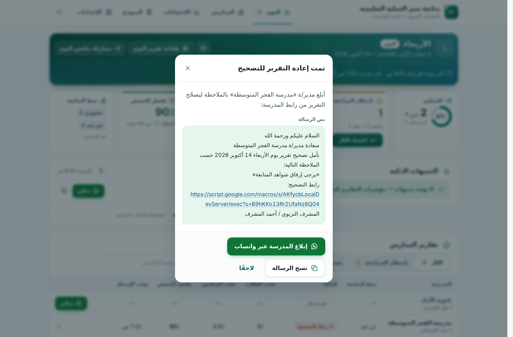
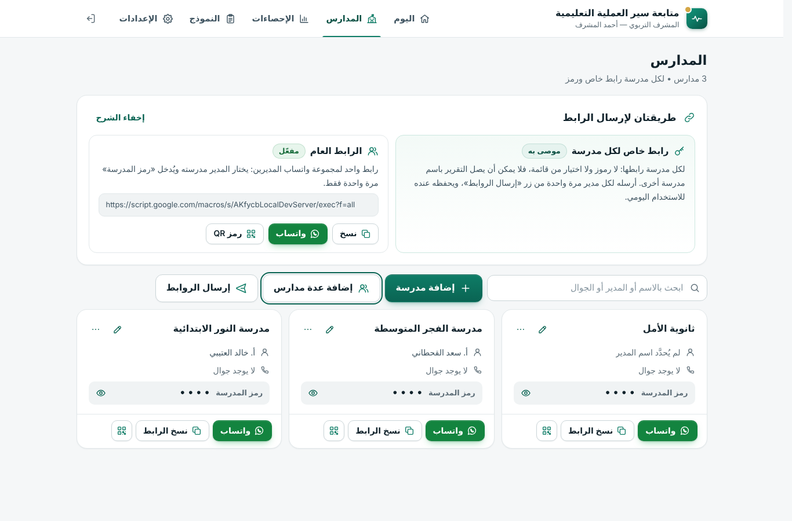
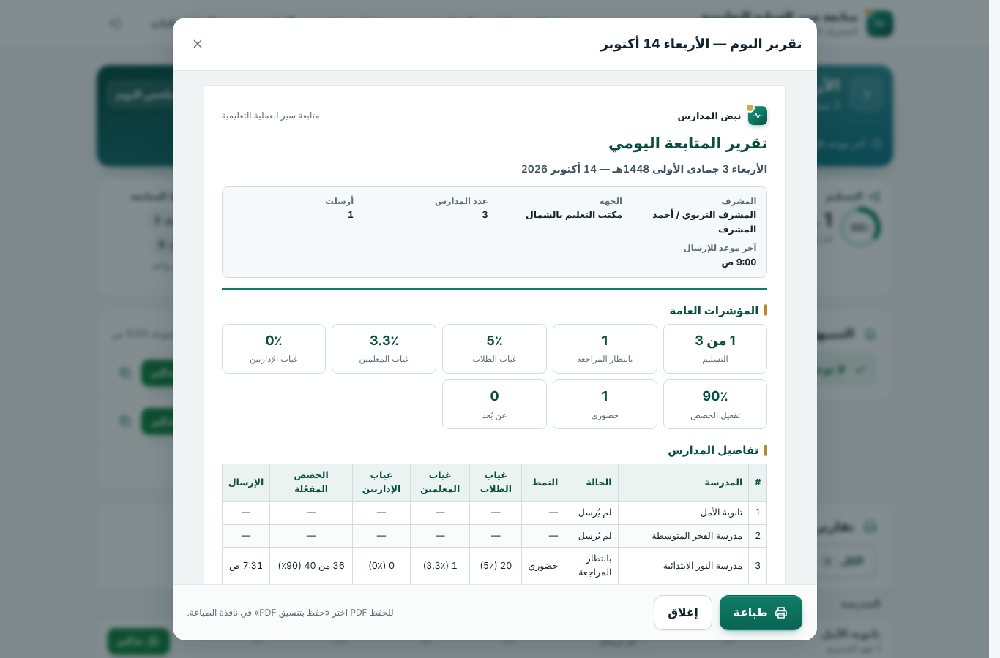
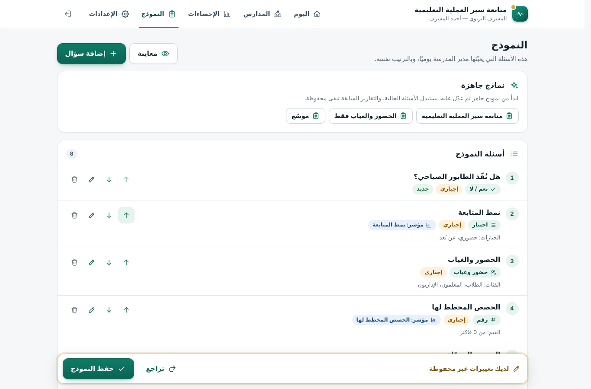
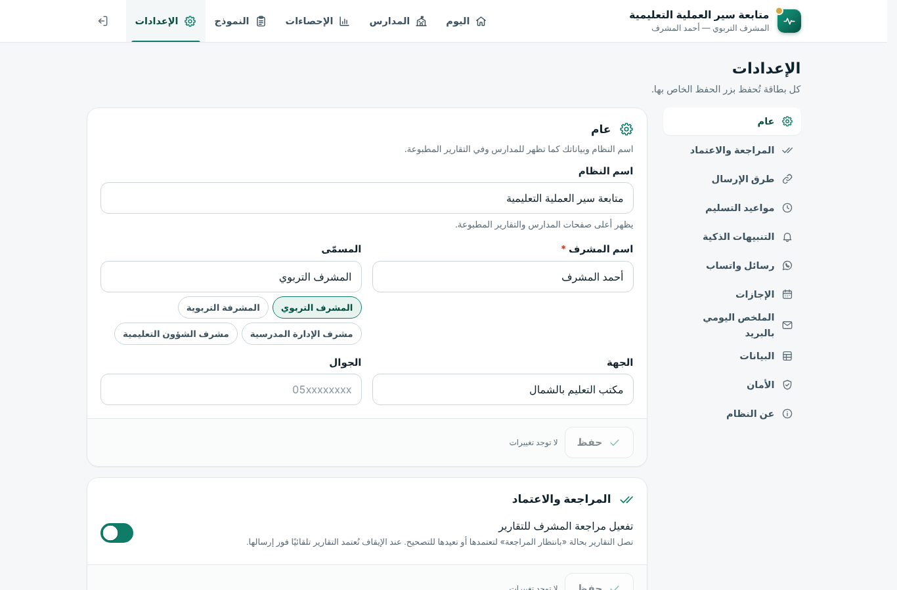
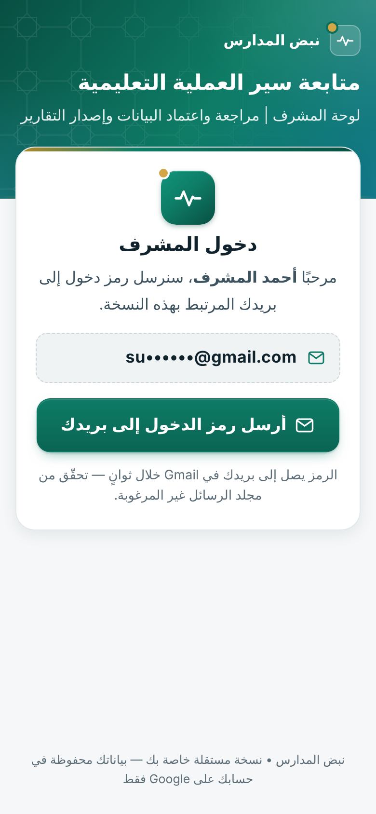
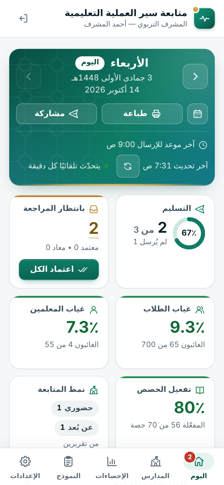
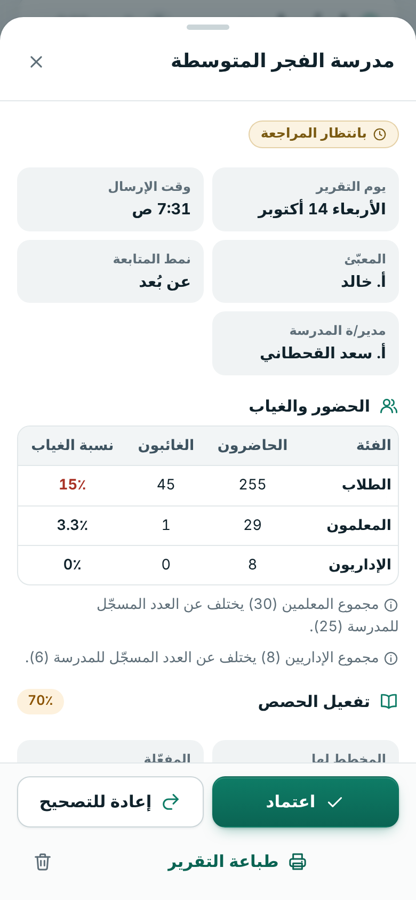
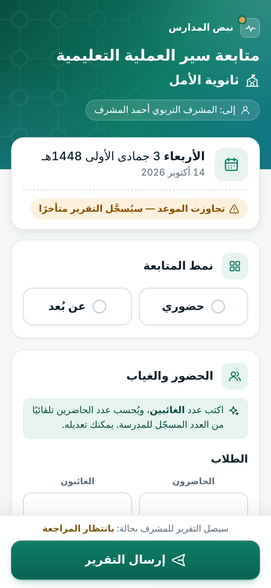

# نبض المدارس

### متابعة سير العملية التعليمية: تقرير يومي من كل مدرسة، ولوحة متابعة للمشرف

**نبض المدارس** نظام عربي بسيط للمشرف التربوي الذي يتابع عدة مدارس.

* **مدير المدرسة** يعبّئ تقرير المتابعة اليومي من جواله في دقيقة واحدة، عبر رابط خاص بمدرسته ودون أي حساب أو كلمة مرور. يشمل التقرير:
  * نمط المتابعة (حضوري / عن بُعد)؛
  * الحضور والغياب للطلاب والمعلمين والإداريين؛
  * تفعيل الحصص، والملاحظات، وصور الشواهد.
* **المشرف** يرى كل التقارير لحظة بلحظة في لوحة واحدة:
  * يعتمد التقرير أو يعيده للتصحيح بملاحظة؛
  * تصله التنبيهات الذكية؛
  * يطبع التقارير ويتابع الإحصاءات عبر الأيام.

البرنامج يعمل على Google Sheets و Apps Script. **كل مشرف يملك نسخته الخاصة في حسابه على Google**، فلا خادم مركزي ولا قاعدة بيانات مشتركة.

## لماذا هو أفضل من نموذج عادي؟

* **رابط خاص لكل مدرسة:** لا اختيار من قائمة ولا رموز. لا يمكن أن يصل التقرير باسم مدرسة أخرى، ولا يحتاج المدير إلى «رقم طلب» أو «رمز تصحيح».
  ويوجد أيضًا **رابط عام** واحد لمجموعة واتساب المديرين، يختار منه المدير مدرسته ويُدخل «رمز المدرسة» (4 أرقام) مرة واحدة.
* **مراجعة واعتماد وإعادة للتصحيح:**
  * يصل كل تقرير بحالة «بانتظار المراجعة»، فيعتمده المشرف أو يعيده بملاحظة.
  * تظهر الملاحظة للمدرسة فورًا مع زر «تصحيح التقرير»، ومعها رسالة واتساب جاهزة للإبلاغ.
  * يمكن إيقاف المراجعة لتُعتمد التقارير تلقائيًا.
* **حسابات تلقائية:**
  * يكتب المدير عدد الغائبين، فيُحسب الحاضرون من العدد المسجّل للمدرسة.
  * تُحسب نسب الغياب، والحصص غير المفعّلة، ونسبة التفعيل.
  * يظهر تنبيه لطيف إن اختلف المجموع عن العدد المسجّل.
* **صور الشواهد مضغوطة تلقائيًا** على الجوال قبل الرفع، وتُحفظ في مجلد خاص في Google Drive، وتظهر في التقرير وتُطبع معه.
* **تنبيهات ذكية:** ارتفاع غياب الطلاب أو المعلمين، ارتفاع مفاجئ مقارنة بالأيام السابقة، ضعف تفعيل الحصص، مدرسة لم ترسل يومين
  متتاليين، تقرير متأخر، تصحيح ينتظر المراجعة.
* **إحصاءات** لأي فترة: الالتزام بالتسليم، ومتوسطات الغياب والتفعيل، ورسوم بيانية، وجدول لكل مدرسة، وتنزيل Excel.
* **تقارير جاهزة للطباعة أو PDF:** تقرير اليوم لكل المدارس، وتقرير مدرسة واحدة مع صورها، وتقرير فترة.
* **واتساب بضغطة:** إرسال الروابط، والتذكير بمن لم يرسل، وإبلاغ المدرسة بالتصحيح، ومشاركة ملخص اليوم.
* **مرن:**
  * مواعيد التسليم وأيام الدوام والإجازات قابلة للضبط؛
  * يمكن قبول الإرسال المتأخر أو إغلاقه؛
  * يمكن إرسال تقرير يوم فائت خلال مدة يحدّدها المشرف؛
  * نماذج جاهزة، ومحرّر أسئلة لتعديل النموذج كما تريد.
* **كل مشرف مستقل تمامًا:** نسخة خاصة، ودخول برمز يصل إلى بريده في Gmail فقط، وإعداداته ومدارسه لا علاقة لها بأي مشرف آخر.
* **بياناتك في حسابك أنت:** ملف Google Sheets تقرؤه وتفرزه متى شئت، ومجلد صور في Google Drive. لا يطّلع عليها أحد غيرك.
* **مصمم للجوال أولًا:** واجهة عربية واضحة، وأزرار كبيرة، وحفظ تلقائي لما يكتبه المدير إن انقطع الإنترنت.
* **محكم:** روابط لا يمكن تخمينها، وحماية من التخمين والإدخال الضار، وفحص لكل صورة وكل رقم على الخادم، وأقفال تمنع تداخل الإرسال.

## لقطات من النظام

### المشرف على الحاسب

<table>
  <tr>
    <td width="50%" valign="top"> لوحة «اليوم»: التسليم، وما ينتظر المراجعة، ونسب الغياب، والتنبيهات الذكية، ومن لم يرسل بعد.</td>
    <td width="50%" valign="top"> تفاصيل تقرير مدرسة: «اعتماد» أو «إعادة للتصحيح» أو «طباعة التقرير».</td>
  </tr>
  <tr>
    <td width="50%" valign="top"> بعد «إعادة للتصحيح»: رسالة جاهزة فيها ملاحظتك ورابط التصحيح، تُرسل للمدرسة عبر واتساب.</td>
    <td width="50%" valign="top"> «المدارس»: رابط خاص لكل مدرسة، والرابط العام لمجموعة المديرين، والإرسال عبر واتساب.</td>
  </tr>
  <tr>
    <td width="50%" valign="top"> الإحصاءات لأي فترة: الالتزام، ونسب الغياب، وتفعيل الحصص، ونمط المتابعة.</td>
    <td width="50%" valign="top"> «تقرير المتابعة اليومي» جاهز للطباعة أو الحفظ PDF.</td>
  </tr>
  <tr>
    <td width="50%" valign="top"> «النموذج»: نماذج جاهزة، ومحرّر لإضافة الأسئلة وترتيبها.</td>
    <td width="50%" valign="top"> «الإعدادات»: المراجعة، والمواعيد، والتنبيهات، ورسائل واتساب، والإجازات، والملخص اليومي بالبريد.</td>
  </tr>
</table>

### المشرف على الجوال

<table>
  <tr>
    <td width="25%" valign="top"> «دخول المشرف» برمز يصل إلى بريدك في Gmail.</td>
    <td width="25%" valign="top"> لوحة «اليوم» على الجوال.</td>
    <td width="25%" valign="top"> مراجعة التقرير واعتماده من الجوال.</td>
    <td width="25%" valign="top"> «إرسال الروابط»: رابط كل مدرسة لمديرها عبر واتساب.</td>
  </tr>
</table>

### مدير المدرسة على الجوال

<table>
  <tr>
    <td width="33%" valign="top"> الرابط العام: يختار المدير مدرسته ويُدخل رمزها.</td>
    <td width="33%" valign="top"> نموذج التقرير اليومي: يكتب المدير الغائبين، ويُحسب الباقي تلقائيًا.</td>
    <td width="33%" valign="top"> إيصال الإرسال مع ملخص التقرير.</td>
  </tr>
  <tr>
    <td width="33%" valign="top"> بعد الموعد: يُقبل التقرير ويُسجَّل «متأخرًا» (أو يُغلق، حسب إعداداتك).</td>
    <td width="33%" valign="top"> ملاحظة المشرف وزر «تصحيح التقرير».</td>
    <td width="33%" valign="top"> «لم ترسل تقرير يوم سابق؟»: إرسال يوم فائت خلال المدة التي تحددها.</td>
  </tr>
</table>

كل اللقطات في [`docs/screenshots`](docs/screenshots).
وللعرض على المشرفين: [`dist/demo.html`](dist/demo.html) صفحة تجريبية تفاعلية فيها البرنامج الحقيقي ببيانات تجريبية، تُنشر كما هي صفحةً على الويب (Claude Artifact).

## البدء السريع

> الشرح المفصّل، خطوة بخطوة مع أسماء الأزرار وحل المشكلات، في **[دليل التثبيت](docs/دليل-التثبيت.md)**.
> وللاستخدام اليومي: **[دليل الاستخدام](docs/دليل-الاستخدام.md)**.

### (أ) لصاحب القالب: تجهيز القالب (مرة واحدة)

1. أنشئ ملف Google Sheets جديدًا (`sheets.new`) وسمِّه «نبض المدارس».
2. «الإضافات» (Extensions) ← «Apps Script». سمِّ المشروع «نبض المدارس».
3. في `Code.gs` احذف كل شيء، والصق محتوى **[`dist/Code.gs`](dist/Code.gs)** كاملًا. هذا ملف واحد فيه البرنامج كله، وصفحاته مضمّنة فيه.
4. اختياري (يُنصح به):
   * «إعدادات المشروع» (Project Settings) ← ضع علامة على «إظهار ملف البيان appsscript.json في المحرّر».
   * افتح `appsscript.json` واستبدل محتواه بـ **[`dist/appsscript.json`](dist/appsscript.json)**، وهو يضبط المنطقة الزمنية وقائمة الأذونات.
5. احفظ (Ctrl+S)، ثم حدّث صفحة الملف. يجب أن تظهر القائمة «📋 نبض المدارس».
6. **لا تنشر القالب، ولا تشغّل معالج التجهيز فيه.** القالب يبقى فارغًا.
7. «مشاركة» (Share) ← «أي مستخدم لديه الرابط» (Anyone with the link) بدور «عارض» (Viewer) ← «نسخ الرابط».
8. حوّل الرابط إلى رابط نسخ: استبدل `/edit…` في آخره بـ `/copy`، هكذا:
   `https://docs.google.com/spreadsheets/d/<المعرّف>/copy`.
   ثم أرسل هذا الرابط للمشرفين.

### (ب) لكل مشرف: التثبيت في 6 خطوات (حوالي 5 دقائق)

1. افتح رابط النسخ واضغط «إنشاء نسخة» (Make a copy). تصير عندك نسخة كاملة في حسابك.
2. من القائمة العلوية في الملف: «الإضافات» (Extensions) ← «Apps Script».
3. اضغط «نشر» (Deploy) ← «نشر جديد» (New deployment) ← أيقونة الترس ⚙ ← «تطبيق ويب» (Web app).
4. «التنفيذ باسم» (Execute as): **أنا** — «من يمكنه الوصول» (Who has access): **أي شخص** (Anyone). ثم «نشر».
5. اضغط «منح الإذن» (Authorize access) ← اختر حسابك ← «خيارات متقدمة» (Advanced) ← «الانتقال إلى … (غير آمن)» ←
   ضع علامة على **«تحديد الكل»** (Select all) ← «متابعة» (Continue).
   * هذه النسخة ملكك أنت، والتحذير يظهر لأن البرنامج لم يُنشر في متجر Google.
   * إذن Google Drive يستخدمه البرنامج لمجلد صور الشواهد الذي يُنشئه فقط.
6. انسخ «رابط تطبيق الويب» (ينتهي بـ `/exec`) وافتحه. سيظهر لك **معالج التجهيز**. احفظ الرابط في المفضلة.

**معالج التجهيز** (خمس خطوات): مرحبًا ← ربط بريدك ← بياناتك ← مدارسك ← جاهز.

* «ربط بريدك»: يصلك رمز من 6 أرقام على Gmail لتأكيد أنك صاحب النسخة.
* «بياناتك»: اسمك ومسمّاك، واختيار نموذج التقرير.
* «مدارسك»: الصق أسماء المدارس، كل مدرسة في سطر.
* بعدها: «المدارس» ← «إرسال الروابط» لترسل لكل مدير رابط مدرسته عبر واتساب.

### (ج) التحديث إلى إصدار جديد

1. في نسختك: «الإضافات» ← «Apps Script» ← افتح `Code.gs` ← احذف محتواه والصق `dist/Code.gs` الجديد ← احفظ.
2. «نشر» ← **«إدارة عمليات النشر»** (Manage deployments) ← أيقونة القلم «تعديل» (Edit) ← «الإصدار» (Version): **«إصدار جديد»** (New version) ← «نشر».
3. **يبقى الرابط نفسه** وتبقى روابط المدارس كما هي، والبيانات لا تتأثر. **لا تنشئ «نشرًا جديدًا»**، لأنه يصنع رابطًا مختلفًا.
4. إن طلب Google أذونات جديدة، أو توقفت الصور: القائمة «📋 نبض المدارس» ← «📖 خطوات التشغيل» ← «تحديد الكل» ← «متابعة».

ولصاحب القالب: حدّث `Code.gs` في القالب أيضًا ليحصل المشرفون الجدد على الإصدار الجديد.

## الخصوصية والأمان باختصار

* **كل البيانات في حساب المشرف:**
  * ملف Google Sheets، وفيه الأوراق «المدارس» و«التقارير» و«السجل» و«ابدأ هنا»؛
  * مجلد «نبض المدارس — شواهد المتابعة» في Google Drive.

  لا تُرسل البيانات إلى أي خادم خارجي، فالكود لا يستخدم إلا خدمات Google في حساب المشرف.
* **دخول المشرف:** برمز لمرة واحدة يصل إلى بريد صاحب النسخة، صالح 10 دقائق. الجلسة 30 يومًا، مع «تسجيل الخروج من كل الأجهزة».
* **روابط المدارس:** 20 حرفًا عشوائيًا، وتستطيع تغيير رابط أي مدرسة فيتوقف القديم فورًا.
  «رمز المدرسة» للرابط العام محمي من التخمين، ويمكن إيقاف الرابط العام.
* **التحقق على الخادم:** كل نص وعدد وصورة يُفحص هناك، والنصوص تُحفظ بطريقة تمنع تحويلها إلى معادلات في Sheets.

التفاصيل التقنية في [`docs/ARCHITECTURE.md`](docs/ARCHITECTURE.md).

## هيكل المستودع

| المسار | المحتوى |
|---|---|
| `src/Code.gs` | كل كود الخادم (Apps Script)، وهو المرجع |
| `src/Admin.html` | لوحة المشرف: معالج التجهيز، والدخول، واليوم، والمدارس، والإحصاءات، والنموذج، والإعدادات |
| `src/School.html` | صفحة مدير المدرسة: النموذج، والإيصال، والتصحيح، والرابط العام |
| `src/Styles.html` / `src/Common.html` | نظام التصميم والأدوات المشتركة في المتصفح |
| `src/appsscript.json` | ملف البيان: المنطقة الزمنية، والأذونات، وإعدادات تطبيق الويب |
| `dist/Code.gs` / `dist/appsscript.json` | **ملف التثبيت الواحد** (يُولَّد آليًا، فلا تعدّله) وملف البيان |
| `dist/demo.html` | نسخة تجريبية تفاعلية للعرض: البرنامج الحقيقي يعمل في المتصفح ببيانات تجريبية، دون Google ودون إرسال أي شيء |
| `tools/` | أدوات البناء (`build-bundle.js`، `build-demo.js`) |
| `test/` | محاكي Apps Script، واختبارات الوحدة، واختبارات المتصفح (Playwright)، وخادم التطوير |
| `docs/` | الأدلة واللقطات و`ARCHITECTURE.md` |

## تشغيل الاختبارات والبناء

يتطلب Node 22. الأوامر تفترض وجود `playwright-core` و Chromium في المسارات المعرّفة في `package.json`.

| الأمر | ماذا يفعل |
|---|---|
| `npm run test:unit` | اختبارات منطق الخادم عبر محاكي Apps Script |
| `npm run test:bundle` | يشغّل ملف التثبيت `dist/Code.gs` وحده، ويتأكد أنه يعمل تمامًا مثل ملفات `src/` |
| `npm run test:e2e` | سيناريوهات كاملة في المتصفح على الجوال والحاسب، وتعيد توليد لقطات `docs/screenshots` (`E2E_SHOTS=0` لتجاوزها) |
| `npm test` | كل ما سبق |
| `npm run build:bundle` | بناء `dist/Code.gs` و`dist/appsscript.json` من `src/` |
| `npm run build` | `build:bundle` ثم بناء النسخة التجريبية `dist/demo.html` (`build:demo`) |
| `npm run dev` | تشغيل البرنامج محليًا على `http://localhost:8787` مع بيئة Google محاكاة؛ رمز الدخول تجده في `/__mail/last-code` |

---

## English

**Nabd (نبض المدارس)** is an Arabic, RTL, mobile-first Google Apps Script web app for an educational supervisor
who oversees several schools. Every school day, each principal fills a short daily follow-up report from a phone,
using a private per-school link with no Google account. The report covers follow-up mode, attendance and absence,
lesson activation, notes and compressed evidence photos.

The supervisor gets a live dashboard where he can:
* approve reports, or return them for correction with a note;
* see smart alerts;
* print day, school and period reports (or save them as PDF);
* view statistics over time.

**Distribution model.** There is no central server. The author publishes a Google Sheets template with the script
bound to it. Each supervisor makes a copy into his own Google account and deploys it once as a web app (Execute as: Me,
Who has access: Anyone). From then on all data lives in his own spreadsheet and Drive folder. Principals use private
links (`?s=<token>`), or a general link (`?f=all`) together with a 4-digit school code. The supervisor signs in with a
one-time code emailed to the copy owner's Gmail.

**Install.** Paste the single-file bundle [`dist/Code.gs`](dist/Code.gs) into the bound script's `Code.gs`. All HTML
is embedded, so no other file is needed. Optionally paste [`dist/appsscript.json`](dist/appsscript.json) as the manifest.
Step-by-step guides are in Arabic:
* [installation](docs/دليل-التثبيت.md)
* [daily use](docs/دليل-الاستخدام.md)

**Develop.**
* `npm run test:unit`, `npm run test:bundle` and `npm run test:e2e` run against a high-fidelity Apps Script mock (`test/gas-mock.js`)
  and Playwright.
* `npm run build` regenerates `dist/` from `src/`: the bundle, and `dist/demo.html`, a self-contained interactive demo
  that runs the real app in the browser on the Apps Script mock with sample data.
* `npm run dev` serves the app locally.

Architecture, data model, API, security model, platform gotchas, test harness and the release process are in
[`docs/ARCHITECTURE.md`](docs/ARCHITECTURE.md).
