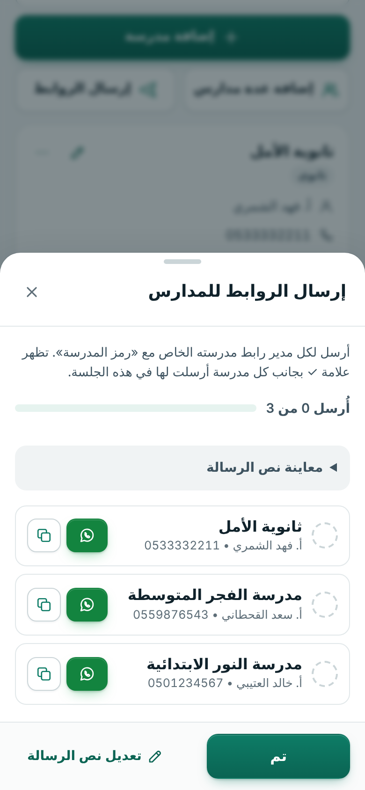
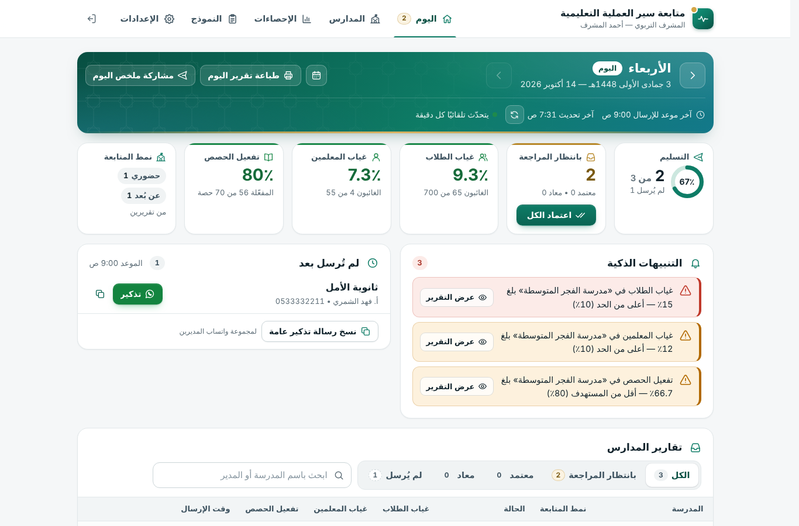
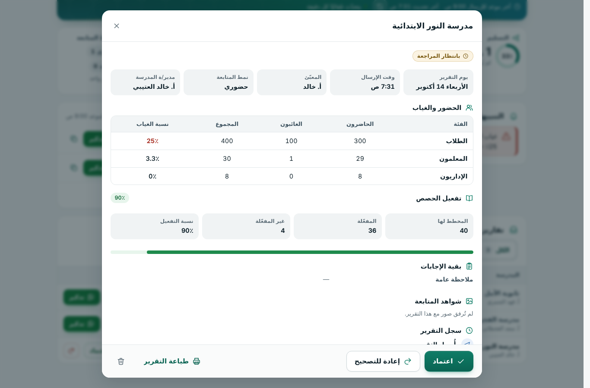
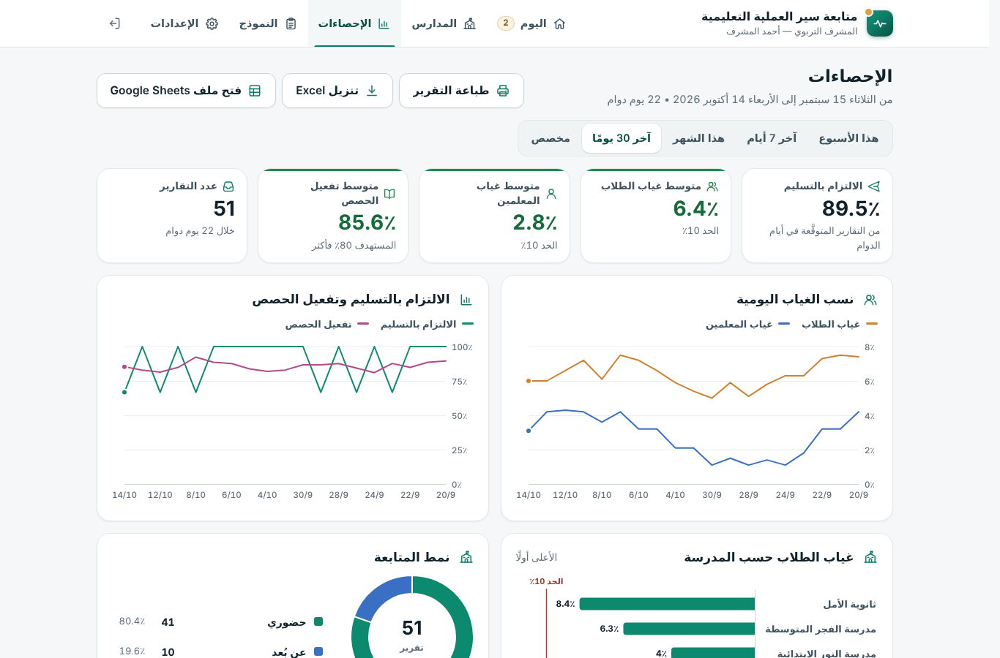
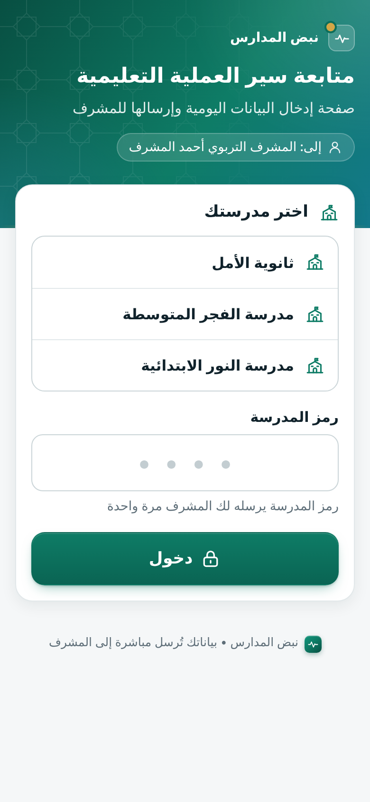
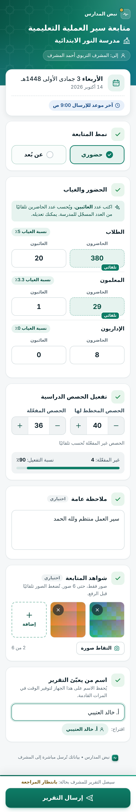
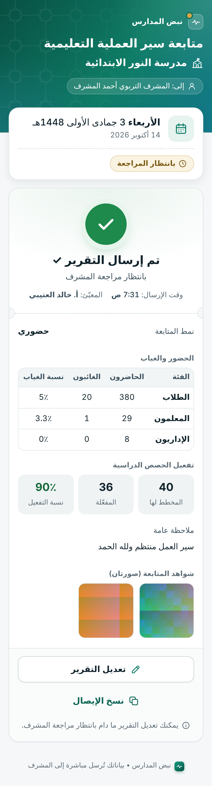
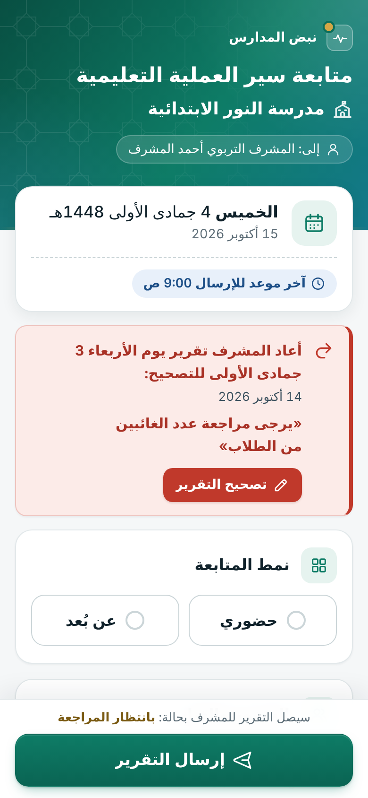
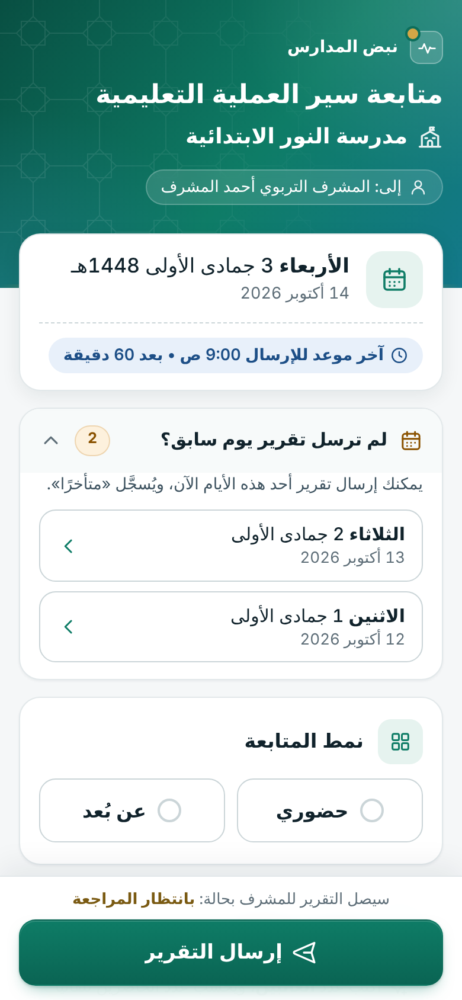

# دليل الاستخدام اليومي: نبض المدارس

دليل قصير لما تفعله كل يوم. الجزء الأول للمشرف، والجزء الثاني لمدير المدرسة؛ ويمكنك إرسال الجزء الثاني للمديرين كما هو.
لم تثبّت البرنامج بعد؟ ابدأ من [دليل التثبيت](دليل-التثبيت.md).

**للمشرف:**
[الدخول](#الدخول) ·
[إرسال الروابط](#إرسال-الروابط-للمدارس) ·
[المدارس](#إضافة-المدارس-وإدارتها) ·
[لوحة اليوم](#لوحة-اليوم) ·
[المراجعة](#مراجعة-التقارير-اعتماد-أو-إعادة-للتصحيح) ·
[التنبيهات](#معنى-التنبيهات-الذكية) ·
[الإحصاءات](#الإحصاءات) ·
[الطباعة](#الطباعة-وحفظ-pdf-والمشاركة) ·
[النموذج](#النموذج-أسئلة-التقرير) ·
[الإعدادات](#الإعدادات) ·
[الإجازات](#الإجازات) ·
[الأيام الفائتة](#التقارير-الفائتة-إرسال-تقرير-يوم-سابق) ·
[ملف البيانات](#ملف-البيانات-google-sheets)

**لمدير المدرسة:**
[فتح الرابط](#فتح-الرابط) ·
[تعبئة التقرير](#تعبئة-التقرير) ·
[الصور](#صور-الشواهد) ·
[الإيصال](#الإيصال-والتعديل) ·
[التصحيح](#تصحيح-تقرير-أعاده-المشرف) ·
[يوم فائت](#إرسال-تقرير-يوم-فائت) ·
[رسائل قد تظهر](#رسائل-قد-تظهر-لك)

---

# الجزء الأول: للمشرف

## الدخول

* افتح رابط لوحة التحكم المحفوظ في المفضلة (ينتهي بـ `/exec`).
  * في أول مرة على أي جهاز: «أرسل رمز الدخول إلى بريدك»، ثم اكتب الرمز، ثم «دخول».
  * تبقى الجلسة مفتوحة 30 يومًا على هذا الجهاز.
* نسيت الرابط، أو ما وصلك رمز الدخول؟ افتح ملف Google Sheets ← «📋 نبض المدارس» ← «🔗 رابط لوحة التحكم»، ثم اضغط «فتح لوحة التحكم»: يُدخلك **مباشرة بدون رمز بالبريد** (الزر صالح مرة واحدة خلال 10 دقائق، لأنه لا يظهر إلا لصاحب الملف).
* في أعلى الشاشة خمسة أقسام: **اليوم · المدارس · الإحصاءات · النموذج · الإعدادات**. على الجوال تجدها في الشريط السفلي.

## إرسال الروابط للمدارس

لكل مدرسة طريقتان للدخول. اختر ما يناسبك، أو استخدم الاثنتين معًا.

### 1) رابط خاص لكل مدرسة (الأفضل)

* لا يحتاج المدير إلى رموز ولا إلى اختيار من قائمة، فلا يمكن أن يصل التقرير باسم مدرسة أخرى.
* «المدارس» ← **«إرسال الروابط»**: تظهر قائمة بكل المدارس.
  * زر **واتساب** يفتح محادثة المدير ومعها رسالة جاهزة فيها رابط مدرسته. إن لم يكن للمدرسة جوال مسجّل، فتختار المحادثة بنفسك.
  * زر النسخ ينسخ الرسالة لتلصقها حيث شئت.
  * تظهر علامة ✓ بجانب كل مدرسة أرسلت لها، ويظهر العدّاد «أُرسل X من Y».
* ترسل الرابط **مرة واحدة**، ويحفظه المدير عنده للاستخدام اليومي.
* من بطاقة أي مدرسة أيضًا: «واتساب»، «نسخ الرابط»، ورمز QR (للطباعة أو المسح بالكاميرا).
* لتعديل نص الرسالة: «تعديل نص الرسالة» أسفل النافذة، أو «الإعدادات» ← «رسائل واتساب».

### 2) الرابط العام + «رمز المدرسة»

* رابط **واحد** تضعه في مجموعة واتساب المديرين. يختار كل مدير مدرسته ويكتب «رمز المدرسة» (4 أرقام) **مرة واحدة**،
  فيتذكّره جهازه بعد ذلك.
* تجد الرابط العام في «المدارس» ← بطاقة «طريقتان لإرسال الرابط» ← «الرابط العام»، ومعه الأزرار «نسخ»، «واتساب»، «رمز QR».
* تجد رمز كل مدرسة في بطاقتها تحت «رمز المدرسة» (اضغط أيقونة العين لإظهاره). ورسالة «إرسال الروابط» تتضمنه تلقائيًا
  ما دام الرابط العام مفعّلًا.
* الحماية من التخمين: بعد 5 محاولات خاطئة لمدرسة واحدة، يتوقف الإدخال لها ربع ساعة.
* لإيقاف الرابط العام: «الإعدادات» ← «طرق الإرسال» ← أوقف «تفعيل الرابط العام لكل المدارس». الروابط الخاصة تبقى تعمل.

## إضافة المدارس وإدارتها

* **«إضافة مدرسة»:**
  * اسم المدرسة، وهو الحقل الإجباري الوحيد.
  * المرحلة، والرقم الوزاري، واسم المدير/ة، وجوال المدير/ة.
  * «الأعداد المرجعية»: عدد الطلاب، وعدد المعلمين، وعدد الإداريين.
* **«إضافة عدة مدارس»:**
  * الصق قائمة، كل مدرسة في سطر، ويمكن نسخها من Excel مباشرة.
  * الترتيب: `اسم المدرسة، اسم المدير، الجوال، عدد الطلاب، عدد المعلمين، عدد الإداريين`، وكل ما بعد الاسم اختياري.
  * عمود الرقم التسلسلي «م» في بداية السطر يُتجاهل تلقائيًا، وكذلك الأسماء المكررة.
* **الأعداد المرجعية مفيدة:** بها يكتب المدير عدد الغائبين فقط، فيُحسب عدد الحاضرين تلقائيًا. وينبَّه إن اختلف المجموع كثيرًا عن العدد المسجّل.
* **خيارات المدرسة** (زر «⋯» في بطاقتها):

  | الخيار | ماذا يفعل |
  |---|---|
  | «تعديل بيانات المدرسة» | تغيير الاسم والمدير والجوال والأعداد |
  | «إرسال الرابط عبر واتساب» | إرسال رابط المدرسة لمديرها |
  | «إنشاء رابط جديد» | **يتوقف الرابط الحالي فورًا**. استخدمه إن وصل الرابط لشخص غير مقصود، ثم أرسل الجديد للمدير |
  | «إنشاء رمز جديد للمدرسة» | يغيّر «رمز المدرسة» الخاص بالرابط العام فقط، ويُخرج الأجهزة التي حفظت المدرسة بالرمز القديم (يكتب المدير الرمز الجديد مرة واحدة). الرابط الخاص لا يتأثر |
  | «إيقاف المدرسة مؤقتًا» | لا تستطيع المدرسة الإرسال، ولا تظهر في متابعة اليوم، حتى تختار «إعادة تفعيل المدرسة» |
  | «حذف المدرسة» | تُحذف من القائمة ويتوقف رابطها، و**تبقى تقاريرها السابقة محفوظة** |

## لوحة «اليوم»

قلب البرنامج: من أرسل؟ من لم يرسل؟ ماذا ينتظر مراجعتك؟

* **التاريخ:**
  * السهمان يتنقلان بين أيام الدوام، وزر التقويم يفتح «الانتقال إلى تاريخ».
  * «العودة إلى اليوم» يرجعك إلى تاريخ اليوم.
  * اللوحة **تتحدّث تلقائيًا كل دقيقة**، وزر التحديث يحدّثها فورًا.
* **المؤشرات:**

  | المؤشر | ماذا يعرض |
  |---|---|
  | «التسليم» | عدد المدارس التي أرسلت من المتوقَّع منها |
  | «بانتظار المراجعة» | التقارير التي تنتظرك. اضغط الرقم للانتقال إليها مباشرة، ومعه زر «اعتماد الكل» |
  | «غياب الطلاب» و«غياب المعلمين» | نسبة الغياب في المدارس التي أرسلت |
  | «تفعيل الحصص» | نسبة الحصص المفعّلة من المخطط لها |
  | «نمط المتابعة» | عدد التقارير لكل نمط (حضوري / عن بُعد) |
* **البطاقات:**

  | البطاقة | ماذا فيها |
  |---|---|
  | «التنبيهات الذكية» | [شرحها هنا](#معنى-التنبيهات-الذكية) |
  | «بانتظار المراجعة من أيام سابقة» | تقارير أيام أخرى لم تراجعها بعد. اضغط المدرسة للانتقال إلى ذلك اليوم |
  | «بانتظار تصحيح المدرسة» | تقارير أعدتها للتصحيح ولم تصحّحها المدرسة بعد |
  | «لم تُرسل بعد» | لكل مدرسة زر «تذكير» يفتح واتساب برسالة فيها رابطها، وزر لنسخ رابطها. وفي أسفل البطاقة «نسخ رسالة تذكير عامة» لمجموعة واتساب المديرين |
* **«تقارير المدارس»:** جدول على الحاسب وبطاقات على الجوال.
  * تصفية حسب الحالة: «الكل»، «بانتظار المراجعة»، «معتمد»، «معاد»، «لم يُرسل».
  * بحث باسم المدرسة أو المدير.
* **يوم الإجازة** يظهر عليه «يوم إجازة»، ولا يُنتظر فيه إرسال.

## مراجعة التقارير: اعتماد أو إعادة للتصحيح

* **من القائمة مباشرة:** بجانب كل تقرير «بانتظار المراجعة» زرّا «اعتماد» و«إعادة».
* **من التفاصيل:** اضغط اسم المدرسة، فتظهر كل البيانات:
  * يوم التقرير، ووقت الإرسال، والمعبّئ، ونمط المتابعة؛
  * جدول الحضور والغياب مع النسب، وتفعيل الحصص، و«بقية الإجابات»؛
  * «شواهد المتابعة»: اضغط أي صورة لتكبيرها؛
  * «سجل التقرير».

أزرار المراجعة:

* **«اعتماد»:** يصير التقرير «معتمد»، ولا تستطيع المدرسة تعديله بعد ذلك.
* **«إعادة للتصحيح»:**
  1. اكتب «ملاحظة التصحيح»، مثل: «يرجى مراجعة عدد الغائبين من الطلاب».
  2. تظهر نافذة «تمت إعادة التقرير للتصحيح» وفيها رسالة جاهزة. اختر «إبلاغ المدرسة عبر واتساب»، أو «نسخ الرسالة»، أو «لاحقًا».
  3. يرى المدير الملاحظة في صفحة مدرسته فورًا مع زر «تصحيح التقرير».
* **بعد أن تصحّح المدرسة** يعود التقرير «بانتظار المراجعة» مع شارة «مصحّح» وملاحظة «صحّحت المدرسة التقرير بعد ملاحظتك».
* **«إلغاء الاعتماد»:** يعيد تقريرًا معتمدًا إلى «بانتظار المراجعة».
* **«اعتماد الكل»** (في مؤشر «بانتظار المراجعة»): يعتمد كل تقارير اليوم المعلّقة. إن كان على بعضها تنبيهات، تذكّرك النافذة بمراجعتها أولًا.
* **حذف التقرير** (أيقونة سلة المحذوفات):
  * تخبرك النافذة إن كانت المدرسة تستطيع إرساله من جديد لذلك اليوم.
  * إن أردت أن تصحّح المدرسة شيئًا، فاستخدم «إعادة للتصحيح» بدل الحذف.
* **لا تريد المراجعة أصلًا؟** «الإعدادات» ← «المراجعة والاعتماد» ← أوقف «تفعيل مراجعة المشرف للتقارير»، فتُعتمد التقارير تلقائيًا فور إرسالها.

## معنى التنبيهات الذكية

تظهر في بطاقة «التنبيهات الذكية» وفي الملخص اليومي بالبريد. وتغيّر حدودها من «الإعدادات» ← «التنبيهات الذكية».

| التنبيه | متى يظهر | الحد الافتراضي |
|---|---|---|
| **غياب الطلاب** (أحمر) | نسبة غياب الطلاب في مدرسة بلغت الحد أو أكثر | 10٪ |
| **غياب المعلمين** | نسبة غياب المعلمين بلغت الحد أو أكثر | 10٪ |
| **تفعيل الحصص** | نسبة الحصص المفعّلة أقل من المستهدف | 80٪ |
| **ارتفاع مفاجئ في غياب الطلاب** | غياب اليوم أعلى من متوسط أيام المدرسة السابقة بهذه النسبة (بشرط وجود 3 أيام سابقة على الأقل) | 50٪ |
| **لم ترسل منذ يومَي عمل** (أحمر) | المدرسة لم ترسل يومَي عمل متتاليين أو أكثر، ويظهر بعد انتهاء موعد الإرسال فقط | — |
| **أرسلت بعد الموعد** | التقرير وصل بعد آخر موعد للإرسال | — |
| **صحّحت التقرير المُعاد** | المدرسة صحّحت تقريرًا أعدته لها، وهو بانتظار مراجعتك | — |

بجانب كل تنبيه زر «عرض التقرير»، أو «تذكير» للمدرسة التي لم ترسل.

## الإحصاءات

* اختر الفترة: «هذا الأسبوع»، «آخر 7 أيام»، «هذا الشهر»، «آخر 30 يومًا»، أو «مخصص» (من تاريخ إلى تاريخ، حتى 190 يومًا).
* **المؤشرات:**
  * «الالتزام بالتسليم»: نسبة التقارير التي وصلت من التقارير المتوقَّعة في أيام الدوام. الإجازات لا تُحسب، واليوم الحالي لا يُحسب
    على المدرسة قبل انتهاء الموعد.
  * متوسطات غياب الطلاب والمعلمين وتفعيل الحصص، و«عدد التقارير».
* **الرسوم:**
  * «نسب الغياب اليومية»؛
  * «الالتزام بالتسليم وتفعيل الحصص»؛
  * «غياب الطلاب حسب المدرسة» (الأعلى أولًا، مع خط الحد)؛
  * «نمط المتابعة».
* **«المدارس خلال الفترة»:** جدول لكل مدرسة، اضغط عنوان أي عمود لترتيبه.
* **الأزرار:**
  * «طباعة التقرير»: تقرير الفترة للطباعة.
  * «تنزيل Excel»: ملف CSV يفتح في Excel بالعربية.
  * «فتح ملف Google Sheets».

## الطباعة وحفظ PDF والمشاركة

* **تقرير اليوم كاملًا:** في لوحة «اليوم» اضغط «طباعة تقرير اليوم» ثم «طباعة».
  * يحتوي التقرير على: المؤشرات العامة، وجدول تفاصيل المدارس، والتنبيهات، والمدارس التي لم ترسل، وخطوط للتوقيع.
* **تقرير مدرسة واحدة:** من تفاصيل التقرير اضغط «طباعة التقرير». يحتوي على صور الشواهد أيضًا.
* **تقرير فترة:** من «الإحصاءات» اضغط «طباعة التقرير».
* **لحفظ أي تقرير PDF:** في نافذة الطباعة اختر «حفظ بتنسيق PDF» (Save as PDF).
* **«مشاركة ملخص اليوم»:** ملخص نصي جاهز. اختر «نسخ الملخص» أو «إرسال عبر واتساب»، لترسله لمديرك مثلًا.

## النموذج (أسئلة التقرير)

«النموذج» هي الأسئلة التي يجيب عنها مدير المدرسة كل يوم، بالترتيب نفسه.

* **«نماذج جاهزة»:**

  | النموذج | محتواه |
  |---|---|
  | «متابعة سير العملية التعليمية» | النموذج المعتاد: نمط المتابعة، والحضور والغياب، والحصص المخطط لها والمفعّلة، وملاحظة عامة، وشواهد المتابعة |
  | «الحضور والغياب فقط» | الحضور والغياب وملاحظات فقط |
  | «موسّع» | يضيف إلى النموذج المعتاد: الطلاب المتأخرين، والمستأذنين، وأسماء المعلمين الغائبين، والحالات الطارئة |

  اختيار نموذج يستبدل الأسئلة الحالية، و**التقارير السابقة تبقى محفوظة كما هي**.
* **«إضافة سؤال»:**
  * اكتب «نص السؤال».
  * اختر «نوع الإجابة»: رقم، نص قصير، نص طويل، اختيار، نعم / لا، حضور وغياب، صور.
  * حدّد إن كانت «إجابة إجبارية»، وأضف «توضيح يظهر تحت السؤال» إن أردت.
  * لسؤال الأرقام تختار «استخدامه في المؤشرات»، مثل «الحصص المفعّلة».
  * لسؤال الاختيار يمكن جعله «نمط المتابعة».
  * المسموح: سؤال واحد من نوع «حضور وغياب»، وسؤال واحد من نوع «صور»، وحتى 25 سؤالًا.
* **ترتيب الأسئلة وتعديلها:** في كل سطر أسهم للأعلى وللأسفل، وزر للتعديل، وزر للحذف.
* **التغييرات لا تصل للمدارس حتى تضغط «حفظ النموذج».** و«تراجع» يلغي ما لم يُحفظ.
* **«معاينة»** تفتح صفحة المدرسة كما يراها المدير، مع مدرسة تجريبية. لا يُرسل منها شيء.

## الإعدادات

كل بطاقة لها زر «حفظ» خاص بها.

| البطاقة | ماذا فيها |
|---|---|
| **عام** | «اسم النظام» (يظهر أعلى صفحات المدارس والتقارير المطبوعة)، و«اسم المشرف»، و«المسمّى»، و«الجهة»، و«الجوال» |
| **المراجعة والاعتماد** | «تفعيل مراجعة المشرف للتقارير». عند الإيقاف تُعتمد التقارير تلقائيًا |
| **طرق الإرسال** | «تفعيل الرابط العام لكل المدارس»، و«رابط تطبيق الويب (ينتهي بـ /exec)»: منه تُبنى كل الروابط ويُحفظ تلقائيًا، فلا تغيّره إلا إن تغيّر رابط النشر |
| **مواعيد التسليم** | «آخر موعد للإرسال يوميًا»، و«أيام الدوام»، و«السماح بالإرسال بعد الموعد» (يُقبل التقرير ويُعلَّم «متأخر»، وعند الإيقاف يُغلق النموذج بعد الموعد لمن لم يرسل)، و«السماح بإرسال تقارير الأيام الفائتة حتى … أيام عمل» |
| **التنبيهات الذكية** | «حد غياب الطلاب»، و«حد غياب المعلمين»، و«الحد الأدنى لتفعيل الحصص»، و«الارتفاع المفاجئ في الغياب» |
| **رسائل واتساب** | «رسالة إرسال الرابط والتذكير»، و«رسالة الإعادة للتصحيح»، مع معاينة حيّة. الكلمات بين { } تُستبدل تلقائيًا: `{المدرسة}` `{الرابط}` `{المشرف}` `{التاريخ}` `{الملاحظة}` `{الرمز}`. وزر «استعادة النص الافتراضي» يرجع النص الأصلي |
| **الإجازات** | [انظر أدناه](#الإجازات) |
| **الملخص اليومي بالبريد** | «إرسال ملخص يومي إلى بريدي» في «وقت الإرسال» الذي تختاره، في أيام الدوام فقط: من أرسل ومن لم يرسل، وما ينتظر مراجعتك، والتنبيهات. قد يصل قبل الوقت أو بعده بربع ساعة تقريبًا؛ ولمعرفة من تأخّر، اختر وقتًا بعد الموعد النهائي بـ 20 دقيقة على الأقل |
| **البيانات** | «فتح ملف البيانات (Google Sheets)»، و«فتح مجلد الشواهد (Google Drive)»، ومقدار المساحة المستخدمة في حسابك |
| **الأمان** | «تسجيل الخروج من هذا الجهاز»، و«تسجيل الخروج من كل الأجهزة» (إن فقدت جوالك مثلًا) |
| **عن النظام** | رقم «الإصدار»، و«البريد المالك»، ورابط لوحة التحكم |

## الإجازات

* «الإعدادات» ← «الإجازات»:
  1. اختر «من تاريخ» (و«إلى تاريخ» إن كانت فترة).
  2. اضغط «إضافة»، ثم «حفظ».
* في أيام الإجازة لا يُنتظر إرسال التقارير، ولا تُحسب في «الالتزام بالتسليم»، ولا يوجد موعد نهائي.
* عند إضافة فترة، تُضاف منها أيام الدوام فقط.
* أيام نهاية الأسبوع تُضبط من «مواعيد التسليم» ← «أيام الدوام»، لا من الإجازات.

## التقارير الفائتة (إرسال تقرير يوم سابق)

* إن نسيت مدرسة إرسال تقرير يوم دوام، يظهر في صفحتها بطاقة **«لم ترسل تقرير يوم سابق؟»**. منها ترسل تقرير ذلك اليوم لاحقًا، ويُسجَّل «متأخرًا».
* المدة من «الإعدادات» ← «مواعيد التسليم» ← «السماح بإرسال تقارير الأيام الفائتة حتى … أيام عمل».
  * الافتراضي يومان، والحد الأقصى 7.
  * `0` يعني غير مسموح.
* عندما تفتح يومًا سابقًا في لوحة «اليوم» (بالسهم أو التقويم) وهو ما زال داخل هذه المدة:
  * زر «تذكير» يرسل للمدرسة رابطًا يفتح ذلك اليوم مباشرة؛
  * «نسخ رسالة تذكير عامة» يذكّرهم بالبطاقة.
* بعد انتهاء المدة تختفي أزرار التذكير لذلك اليوم، ويُحسب «لم يُرسل».

## ملف البيانات (Google Sheets)

كل بياناتك في ملفك:

* **«المدارس»:** المدارس وروابطها ورموزها.
* **«التقارير»:** كل تقرير في سطر، مع أعمدة مقروءة لكل سؤال بعد العمود «البيانات».
* **«السجل»:** ما تم من عمليات، مثل الدخول والاعتماد والحذف والإعدادات.
* **«ابدأ هنا»:** خطوات التشغيل.

يمكنك فرز البيانات وتصفيتها، وعمل جداول محورية عليها. لكن:

* **لا تُدرج أعمدة ولا تحذفها ولا تنقلها** في «المدارس» و«التقارير»، ولا تغيّر أسماء الأوراق أو نصوص العناوين.
* أضف أعمدتك **بعد آخر عمود** فقط.
* إن عدّلت الترتيب بالخطأ، يتوقف البرنامج عن الكتابة ويخبرك برسالة تذكر العمود المقصود. تراجع بـ Ctrl+Z.
* **لا تشارك ملف البيانات مع أحد:** فيه روابط المدارس ورموزها.

---

# الجزء الثاني: لمدير المدرسة

## فتح الرابط

* **إن وصلك رابط خاص بمدرستك:** افتحه، فيظهر نموذج مدرستك مباشرة.
  * احفظه في المفضلة، أو أضفه إلى الشاشة الرئيسية للجوال؛ ستستخدمه كل يوم.
  * لا تحتاج إلى حساب Google ولا إلى كلمة مرور.
* **إن وصلك الرابط العام:**
  1. اختر مدرستك من القائمة تحت «اختر مدرستك».
  2. اكتب «رمز المدرسة» الذي أرسله لك المشرف، ثم «دخول».
  3. في المرات التالية تظهر «متابعة باسم: مدرستك»، فاضغط «متابعة». ولاختيار مدرسة أخرى: «تغيير المدرسة».
* قد تظهر أعلى الصفحة عبارة صغيرة من Google بأن التطبيق أنشأه مستخدم آخر. هذا طبيعي في كل البرامج المبنية على Google Apps Script.

  
  &nbsp;
  

## تعبئة التقرير

يستغرق دقيقة واحدة تقريبًا:

1. **التاريخ والموعد:** أعلى الصفحة تاريخ اليوم (هجري وميلادي)، وتحته شارة الموعد:
   * «آخر موعد للإرسال 9:00 ص»: ما زلت في الوقت.
   * «تجاوزت الموعد — سيُسجَّل التقرير متأخرًا»: يُقبل التقرير، ويُعلَّم متأخرًا.
   * «انتهى وقت الإرسال»: أوقف المشرف الإرسال المتأخر. تواصل معه.
2. **نمط المتابعة:** اضغط «حضوري» أو «عن بُعد».
3. **الحضور والغياب:**
   * اكتب عدد **الغائبين**، فيُحسب عدد **الحاضرين** تلقائيًا من العدد المسجّل للمدرسة، وتظهر عليه كلمة «تلقائي».
   * يمكنك تعديل عدد الحاضرين.
   * تظهر بجانب كل فئة «نسبة الغياب».
   * إن اختلف المجموع كثيرًا عن العدد المسجّل يظهر تنبيه لطيف للتأكد، ولا يمنعك من الإرسال.
4. **تفعيل الحصص:**
   * أدخل «الحصص المخطط لها» و«الحصص المفعّلة» بالأزرار − و + أو بالكتابة.
   * تُحسب «غير المفعّلة» و«نسبة التفعيل» تلقائيًا.
   * لا يمكن أن تزيد المفعّلة على المخطط لها.
5. **ملاحظة عامة** إن وُجدت (اختياري).
6. **صور الشواهد** (اختياري، [التفاصيل أدناه](#صور-الشواهد)).
7. **«اسم من يعبّئ التقرير»:** يُحفظ على جهازك فلا تكتبه كل مرة.
8. اضغط **«إرسال التقرير»** في أسفل الشاشة.

> **ما تكتبه محفوظ على جهازك تلقائيًا حتى ترسله.**
> * إن انقطع الإنترنت أو أُغلقت الصفحة، ستجد ما كتبته عند فتحها مرة أخرى، مع عبارة «استعدنا ما كتبته سابقًا».
> * «البدء من جديد» يمسح ما كتبته.
> * إن فشل الإرسال بسبب الشبكة، اضغط «إعادة المحاولة».

## صور الشواهد

* اضغط «اضغط لإضافة صور الشواهد» لتختار من المعرض أو الكاميرا، أو «التقاط صورة» لفتح الكاميرا مباشرة. وزر «إضافة» يضيف صورًا أخرى.
* **تُصغَّر الصور تلقائيًا قبل الرفع**، فلا تقلق من حجمها. ويظهر تقدّم الرفع على كل صورة.
* الحد الأقصى يحدّده المشرف، ويظهر بجانب الصور، مثل «2 من 6».
* لحذف صورة اضغط × عليها. إن فشل رفع صورة اضغط «إعادة».
* **زر الإرسال يتفعّل بعد اكتمال رفع كل الصور.**

## الإيصال والتعديل

* بعد الإرسال يظهر الإيصال **«تم إرسال التقرير ✓»** مع حالته («بانتظار مراجعة المشرف»)، ووقت الإرسال، وملخص لكل ما أرسلت، والصور.
* **«تعديل التقرير»:** يمكنك تعديل التقرير ما دام بانتظار مراجعة المشرف. بعد التعديل اضغط «إرسال التعديل».
* **«نسخ الإيصال»:** ينسخ نصًا مختصرًا تحتفظ به أو ترسله.
* عندما يعتمد المشرف التقرير تظهر **«تم اعتماد التقرير ✓»**، ولا يمكن تعديله بعدها.

## تصحيح تقرير أعاده المشرف

* إن أعاد المشرف تقريرًا للتصحيح، يظهر في صفحة مدرستك صندوق أحمر:
  **«أعاد المشرف تقرير يوم … للتصحيح:»**، وتحته ملاحظة المشرف.
* اضغط **«تصحيح التقرير»**، فتُفتح بيانات ذلك اليوم كما أرسلتها. عدّل ما يلزم، ثم اضغط **«إرسال التصحيح»**.
* يصل التصحيح للمشرف ليراجعه من جديد. وتستطيع التصحيح مهما مرّ من أيام.

## إرسال تقرير يوم فائت

* إن نسيت إرسال تقرير يوم دوام، تظهر في صفحتك بطاقة **«لم ترسل تقرير يوم سابق؟»** ومعها عدد الأيام.
* اضغطها، ثم اختر اليوم، فيُفتح نموذج «تقرير يوم فائت — يُسجَّل متأخرًا».
* اكتب بيانات **ذلك اليوم**، ثم اضغط «إرسال تقرير يوم …».
* «العودة إلى تقرير اليوم» يرجعك إلى تقرير اليوم.
* هذه الإمكانية متاحة لأيام محدودة فقط، يحدّدها المشرف.

## أيام الإجازة

* في يوم الإجازة أو خارج أيام الدوام تظهر «اليوم إجازة» أو «اليوم ليس من أيام الدوام»، ولا يلزمك الإرسال.
* إن احتجت إلى الإرسال، فاضغط «إرسال تقرير على أي حال».

## رسائل قد تظهر لك

| الرسالة | ماذا تفعل |
|---|---|
| «الرابط غير صحيح أو تم تغييره…» | تأكد أنك فتحت **آخر رابط** أرسله لك المشرف، أو اطلبه منه |
| «هذه المدرسة موقوفة مؤقتًا من قبل المشرف.» | تواصل مع المشرف |
| «انتهى وقت الإرسال لهذا اليوم» | انتهى الموعد والإرسال المتأخر متوقف؛ تواصل مع المشرف. ما كتبته يبقى محفوظًا على جهازك |
| «تم اعتماد هذا التقرير ولا يمكن تعديله» | اعتمده المشرف؛ إن احتجت إلى تعديل فاطلب منه إعادته للتصحيح |
| «النظام غير متاح مؤقتًا. تواصل مع المشرف.» | عند المشرف ما يحتاج إلى إصلاح في ملفه؛ أخبره |
| «لم تُمنح صلاحية Google Drive…» | أرسل التقرير بدون صور الآن، وأبلغ المشرف ليمنح الإذن |
| «تعذّر حفظ الصورة لأن مساحة Google Drive لدى المشرف ممتلئة…» | أرسل التقرير بدون صور وأبلغ المشرف |
| «انقطع الاتصال بالإنترنت — ما تكتبه محفوظ على جهازك.» | تابع الكتابة، وأرسل عندما يعود الاتصال |
| «النظام مشغول بطلبات أخرى الآن…» | انتظر لحظات ثم أعِد المحاولة |
| «الدخول برمز المدرسة متوقف مؤقتًا بسبب محاولات خاطئة كثيرة…» | كُتبت رموز خاطئة كثيرة على الرابط العام؛ استخدم رابط مدرستك الخاص (يعمل دائمًا)، أو حاول لاحقًا |
| «محاولات كثيرة، حاول بعد ربع ساعة» | كُتب رمز مدرستك خطأً عدة مرات؛ انتظر ربع ساعة أو استخدم الرابط الخاص |

