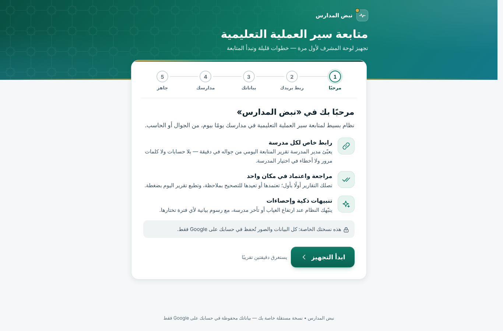

# دليل التثبيت: نبض المدارس

هذا الدليل لمن لا يعرف البرمجة. ستحتاج إلى **حاسب** (لابتوب أو مكتبي) ومتصفح Chrome، وحوالي **عشر دقائق**، مرة واحدة فقط.
بعد التثبيت تستخدم البرنامج من الجوال أو الحاسب كما تشاء.

> **ملاحظة عن أسماء الأزرار:** نكتب اسم كل زر كما يظهر في Google باللغة العربية بين «»، ونضع اسمه الإنجليزي بين
> قوسين، لأن بعض الشاشات قد تظهر بالإنجليزية حسب لغة حسابك. إذا اختلفت كلمة قليلًا عمّا تراه، فابحث عن الاسم الإنجليزي.

**في هذا الدليل:**

1. [الجزء الأول: تجهيز القالب (لصاحب القالب فقط)](#الجزء-الأول-تجهيز-القالب-لصاحب-القالب-فقط)
2. [الجزء الثاني: تثبيت نسختك (لكل مشرف)](#الجزء-الثاني-تثبيت-نسختك-لكل-مشرف)
3. [الجزء الثالث: معالج التجهيز (أول فتح للرابط)](#الجزء-الثالث-معالج-التجهيز-أول-فتح-للرابط)
4. [شاشة «لم تتحقّق Google من هذا التطبيق»: ماذا تعني ولماذا هي آمنة هنا](#شاشة-لم-تتحقّق-google-من-هذا-التطبيق-ماذا-تعني-ولماذا-هي-آمنة-هنا)
5. [ماذا يفعل البرنامج بكل إذن؟](#ماذا-يفعل-البرنامج-بكل-إذن)
6. [تحديث البرنامج إلى إصدار جديد](#تحديث-البرنامج-إلى-إصدار-جديد)
7. [حل المشكلات](#حل-المشكلات)

---

## قبل أن تبدأ

* **حساب Gmail شخصي هو الأفضل.** حسابات الجهات (Google Workspace) قد يمنع مسؤولها الخيار «أي شخص» عند النشر، فلا تفتح
  روابط المدارس لمن ليس لديه حساب في الجهة نفسها.
* **سجّل الدخول بحساب واحد فقط في المتصفح أثناء التثبيت.** إن كان لديك أكثر من حساب Google، فاستخدم نافذة تصفّح متخفٍّ
  (Ctrl+Shift+N) وسجّل الدخول فيها بالحساب الذي تريد أن يكون صاحب النسخة.
* كل شيء يُحفظ في حسابك أنت: ملف Google Sheets، ومجلد صور في Google Drive. لا يوجد خادم خارجي، ولا جهة أخرى تطّلع على بياناتك.

---

## الجزء الأول: تجهيز القالب (لصاحب القالب فقط)

> هذا الجزء يقوم به **شخص واحد** فقط (مثلًا أحمد) لإعداد «القالب» الذي ينسخ منه كل المشرفين.
> **إن كنت مشرفًا وصلك رابط النسخ، فتجاوز هذا الجزء وانتقل إلى [الجزء الثاني](#الجزء-الثاني-تثبيت-نسختك-لكل-مشرف).**

ستحتاج إلى ملف `dist/Code.gs` من هذا المستودع، وهو ملف واحد فيه البرنامج كاملًا. ويمكنك أيضًا استخدام `dist/appsscript.json`، وهو اختياري.

1. **أنشئ ملف Google Sheets جديدًا.** اكتب في شريط العنوان `sheets.new`، أو من Google Drive اضغط «جديد» (New) ←
   «جداول بيانات Google» (Google Sheets).
2. **سمِّ الملف.** اضغط على «جدول بيانات بلا عنوان» (Untitled spreadsheet) أعلى الصفحة واكتب: `نبض المدارس`.
3. **افتح محرّر البرنامج.** من القائمة العلوية: «الإضافات» (Extensions) ← «Apps Script». ستُفتح صفحة جديدة.
4. **سمِّ المشروع.** اضغط على «مشروع بلا عنوان» (Untitled project) أعلى الصفحة، واكتب `نبض المدارس`، ثم «إعادة تسمية» (Rename).
   سيرى المشرفون هذا الاسم في شاشة الأذونات، فالاسم الواضح يطمئنهم.
5. **الصق البرنامج.**
   * في قائمة «الملفات» (Files) على الجانب ستجد ملفًا واحدًا، اسمه عادة `Code.gs`. اضغط عليه.
   * اضغط داخل الكود، ثم Ctrl+A لتحديد الكل، ثم Delete لحذف ما فيه.
   * افتح الملف `dist/Code.gs` وانسخ **كل** محتواه، ثم الصقه بـ Ctrl+V.
   * هذا الملف وحده يكفي؛ صفحات البرنامج كلها مضمّنة فيه، فلا تحتاج إلى إضافة ملفات HTML.
   * الملف كبير (حوالي 0.8 ميجابايت)، فقد يستغرق النسخ واللصق بضع ثوانٍ. تأكد أن آخر سطر فيه هو `};`.
6. **ملف البيان (اختياري، ويُنصح به):**
   * اضغط «إعدادات المشروع» (Project Settings ⚙) في الشريط الجانبي.
   * ضع علامة على «إظهار ملف البيان appsscript.json في المحرّر» (Show "appsscript.json" manifest file in editor).
   * ارجع إلى «المحرّر» (Editor ‹›). سيظهر ملف `appsscript.json`؛ افتحه واستبدل كل محتواه بمحتوى `dist/appsscript.json`.

   هذا الملف يضبط المنطقة الزمنية على الرياض، ويحدّد بدقة قائمة الأذونات التي يطلبها البرنامج.
   إذا تجاوزت هذه الخطوة فسيعمل البرنامج أيضًا، لأن Google يستنتج الأذونات من الكود.
7. **احفظ.** اضغط أيقونة «حفظ المشروع» (Save project)، وهي على شكل قرص، أو Ctrl+S. تأكد من عدم ظهور رسالة خطأ حمراء.
8. **تأكد من سلامة اللصق.** ارجع إلى تبويب ملف Google Sheets وحدّث الصفحة (F5). بعد ثوانٍ تظهر في الأعلى قائمة جديدة
   **«📋 نبض المدارس»**، وقد تظهر ورقة **«ابدأ هنا»**. إن لم تظهر الورقة فلا بأس، فستظهر في نسخة كل مشرف عند فتحها.
9. **مهم جدًا:**
   * **لا تضغط «نشر» (Deploy)** في القالب.
   * **لا تضغط عناصر القائمة «📋 نبض المدارس»**.
   * **لا تُضف مدارس.**

   القالب يبقى فارغًا، ومنه ينسخ كل مشرف نسخته الخاصة.
10. **شارك القالب للعرض فقط.**
    * اضغط «مشاركة» (Share) أعلى الملف.
    * تحت «الوصول العام» (General access) اختر «أي مستخدم لديه الرابط» (Anyone with the link)، واترك الدور «عارض» (Viewer).
    * اضغط «نسخ الرابط» (Copy link)، ثم «تم» (Done).
11. **حوّل الرابط إلى «رابط نسخ».** الرابط المنسوخ يشبه هذا:

    `https://docs.google.com/spreadsheets/d/1AbC…xyz/edit?usp=sharing`

    احذف كل ما بعد المعرّف ابتداءً من `/edit`، واكتب مكانه `/copy`:

    `https://docs.google.com/spreadsheets/d/1AbC…xyz/copy`

    عندما يفتح أي مشرف هذا الرابط، تسأله Google مباشرة إن كان يريد إنشاء نسخة، فيحصل على نسخة كاملة في حسابه.
12. **أرسل «رابط النسخ» للمشرفين** مع هذا الدليل (من [الجزء الثاني](#الجزء-الثاني-تثبيت-نسختك-لكل-مشرف)).

> تستطيع حذف القالب لاحقًا دون أن يتأثر أي مشرف، فكل نسخة مستقلة تمامًا. لكن أبقِه إن أردت أن تصل النسخة الجديدة إلى المشرفين الجدد.

---

## الجزء الثاني: تثبيت نسختك (لكل مشرف)

مرة واحدة فقط، وتستغرق حوالي خمس دقائق. هذه الخطوات الست هي نفسها المكتوبة في ورقة «ابدأ هنا» داخل الملف، وفي القائمة
«📋 نبض المدارس» ← «📖 خطوات التشغيل».

### الخطوة 1: أنشئ نسختك

افتح **رابط النسخ** الذي وصلك، واضغط **«إنشاء نسخة» (Make a copy)**.
تصير عندك نسخة كاملة في حسابك (ملف Google Sheets ومعه البرنامج)، وتجدها في Google Drive باسم مثل «نسخة من نبض المدارس»
(Copy of …). يمكنك إعادة تسميتها كما تحب.

### الخطوة 2: افتح البرنامج

داخل نسختك، من القائمة العلوية في الملف: **«الإضافات» (Extensions) ← «Apps Script»**.
تُفتح صفحة فيها الكود. **لا تغيّر فيه شيئًا.**

### الخطوة 3: ابدأ النشر

اضغط الزر الأزرق **«نشر» (Deploy)** أعلى الصفحة ← **«نشر جديد» (New deployment)** ← أيقونة الترس **⚙** بجانب
«اختيار النوع» (Select type) ← **«تطبيق ويب» (Web app)**.

### الخطوة 4: اختر الإعدادات الصحيحة

| الخانة | اختر |
|---|---|
| «الوصف» (Description) | اختياري، مثلًا: `نبض المدارس` |
| «التنفيذ باسم» (Execute as) | **«أنا» (Me)** مع بريدك |
| «من يمكنه الوصول» (Who has access) | **«أي شخص» (Anyone)** |

ثم اضغط **«نشر» (Deploy)**.

> **انتبه** في «من يمكنه الوصول»: اختر **«أي شخص» (Anyone)** وليس «أي شخص لديه حساب Google»
> (Anyone with Google account). الخيار الثاني يجبر مدير المدرسة على تسجيل الدخول، وكثير منهم لا يملك حسابًا أو لا يتذكره.

### الخطوة 5: امنح الإذن

1. اضغط **«منح الإذن» (Authorize access)**.
2. اختر حسابك.
3. تظهر شاشة **«لم تتحقّق Google من هذا التطبيق» (Google hasn't verified this app)**. هذا متوقع
   ([لماذا؟](#شاشة-لم-تتحقّق-google-من-هذا-التطبيق-ماذا-تعني-ولماذا-هي-آمنة-هنا)).
4. اضغط **«خيارات متقدمة» (Advanced)** ← **«الانتقال إلى نبض المدارس (غير آمن)» (Go to … (unsafe))**.
5. في قائمة الأذونات ضع علامة على **«تحديد الكل» (Select all)** ← **«متابعة» (Continue)**، أو «سماح» (Allow) في بعض الحسابات.

> **مهم:** لا تترك أي إذن دون علامة. إن تركت إذن Google Drive مثلًا، فلن تُرفع صور الشواهد، وسترى المدارس رسالة تطلب
> منك منح الإذن. الإصلاح سهل: [انظر حل المشكلات](#الصور-لا-تُرفع-أو-رسالة-لم-تُمنح-صلاحية-google-drive).

### الخطوة 6: احفظ رابطك وافتحه

1. تظهر نافذة فيها **«رابط تطبيق الويب» (Web app URL)**، وهو يبدأ بـ `https://script.google.com/macros/s/` وينتهي بـ `/exec`.
2. اضغط **«نسخ» (Copy)**، ثم **«تم» (Done)**.
3. افتح الرابط في المتصفح، فيظهر لك **معالج التجهيز**.
4. **احفظ هذا الرابط في المفضلة** على حاسبك وجوالك؛ هو باب لوحة التحكم الخاصة بك.

> نسيت الرابط، أو ما وصلك رمز الدخول؟ افتح ملف Google Sheets ← القائمة «📋 نبض المدارس» ← «🔗 رابط لوحة التحكم» ← «فتح لوحة التحكم»: يُدخلك مباشرة بدون رمز (مرة واحدة خلال 10 دقائق).
> **لا ترسل هذا الرابط للمدارس.** لكل مدرسة رابطها الخاص، وتجده داخل اللوحة في قسم «المدارس».

---

## الجزء الثالث: معالج التجهيز (أول فتح للرابط)

عند أول فتح للرابط يظهر معالج من خمس خطوات: **مرحبًا · ربط بريدك · بياناتك · مدارسك · جاهز**.

1. **مرحبًا:** اضغط «ابدأ التجهيز».
2. **ربط بريدك:**
   * يظهر لك «بريد Gmail المرتبط بهذه النسخة» مخفيًا جزئيًا، مثل `ah••••••@gmail.com`.
   * اضغط «أرسل الرمز»، فيصلك رمز من 6 أرقام على بريدك خلال ثوانٍ. إن لم تجده فابحث في **الرسائل غير المرغوبة (Spam)**.
   * اكتب الرمز، ثم «تحقّق ومتابعة».
3. **بياناتك:**
   * اكتب الاسم الكامل. هذه الخانة إجبارية، وما بعدها اختياري.
   * المسمّى: يمكنك اختياره من الأزرار المقترحة.
   * الجهة ورقم الجوال.
   * «اسم النظام»: الافتراضي «متابعة سير العملية التعليمية».
   * «نموذج التقرير اليومي»: اختر أحد النماذج الجاهزة. المقترح «متابعة سير العملية التعليمية» (موصى به)، وتستطيع تعديل الأسئلة لاحقًا.
   * ثم «التالي».
4. **مدارسك:**
   * اكتب اسم كل مدرسة في سطر، أو الصق قائمة من Excel مباشرة.
   * يمكنك إضافة بيانات اختيارية بعد الاسم مفصولة بفاصلة، بهذا الترتيب: **اسم المدرسة، اسم المدير، الجوال، عدد الطلاب، عدد المعلمين، عدد الإداريين**.
   * ثم «حفظ ومتابعة»، أو «تخطي» إن أردت إضافة المدارس لاحقًا.
5. **جاهز:** اضغط «انتقل إلى لوحة التحكم».

> إن ظهرت في خطوة «مدارسك» خانة **«رابط تطبيق الويب (ينتهي بـ /exec)»**، فأنت فتحت الصفحة من رابط الاختبار
> (المنتهي بـ `/dev`). الصق فيها رابط النشر المنتهي بـ `/exec` من «نشر» ← «إدارة عمليات النشر» (Manage deployments)، لأن روابط
> المدارس تُبنى منه.

**الخطوة التالية:** أرسل لكل مدير رابط مدرسته من **«المدارس» ← «إرسال الروابط»**. التفاصيل في
[دليل الاستخدام](دليل-الاستخدام.md).

### الدخول بعد ذلك

كلما فتحت رابطك من جهاز جديد تظهر شاشة «دخول المشرف»:

1. اضغط «أرسل رمز الدخول إلى بريدك».
2. اكتب الرمز الذي يصلك، ثم «دخول».

تبقى الجلسة مفتوحة 30 يومًا على الجهاز نفسه، وتتجدّد مع الاستخدام.

---

## شاشة «لم تتحقّق Google من هذا التطبيق»: ماذا تعني ولماذا هي آمنة هنا

* تظهر هذه الشاشة لكل برنامج Apps Script لم يمرّ بمراجعة Google الرسمية للتطبيقات المنشورة للعامة.
  البرامج التي يكتبها الناس لأنفسهم داخل حساباتهم لا تمر بهذه المراجعة، فتظهر الشاشة دائمًا.
* **النسخة ملكك أنت:** الكود موجود داخل ملفك، ويعمل في حسابك، ويحفظ في حسابك. لا يُرسل بياناتك إلى أي جهة أخرى؛
  الكود لا يتصل بأي خدمة خارج حسابك في Google، ولا يستخدم خدمة جلب الروابط (UrlFetch).
  الصفحات تحمّل من الإنترنت الخط العربي (Google Fonts) ومكتبة رمز QR فقط، ولا تُرسل إليهما أي بيانات.
* أنت وحدك من يمنح الإذن. **مديرو المدارس لا يرون هذه الشاشة أبدًا، ولا يحتاجون إلى حساب Google.**
* يمكنك سحب الإذن في أي وقت من صفحة حسابك: «الأمان» (Security) ← «اتصالاتك بتطبيقات وخدمات الجهات الخارجية» (Your connections to third-party apps & services).
  عندها يتوقف البرنامج حتى تمنح الإذن من جديد.

---

## ماذا يفعل البرنامج بكل إذن؟

تختلف صياغة Google قليلًا من حساب لآخر، لكن هذه هي الأذونات وسبب كل منها:

| الإذن | لماذا يحتاجه البرنامج |
|---|---|
| عرض جداول بيانات Google وتعديلها | لحفظ المدارس والتقارير وقراءتها في ملفك («المدارس»، «التقارير»، «السجل»). |
| عرض ملفات Google Drive وإنشاؤها وتعديلها | لإنشاء مجلد **«نبض المدارس — شواهد المتابعة»** وحفظ صور الشواهد فيه وعرضها. يطلب Google هذا الإذن بصيغته العامة لأن خدمة Drive في Apps Script لا تعمل بإذن أضيق، لكن البرنامج **لا يتصفح ملفاتك ولا يبحث فيها**؛ يتأكد أن كل صورة يفتحها موجودة داخل مجلده هو. |
| إرسال بريد إلكتروني باسمك | لإرسال رمز الدخول، والملخص اليومي إن فعّلته. الرسائل تذهب **إلى بريدك أنت فقط**. |
| التشغيل عندما لا تكون موجودًا | لإرسال «الملخص اليومي بالبريد» في الوقت الذي تختاره. |
| عرض محتوى داخل نوافذ تطبيقات Google | لنوافذ القائمة «📋 نبض المدارس» داخل ملف Google Sheets. |
| معرفة عنوان بريدك الإلكتروني | لمعرفة صاحب النسخة، فيُرسَل رمز الدخول إليه وحده. |

---

## تحديث البرنامج إلى إصدار جديد

عندما يرسل لك صاحب القالب ملف `Code.gs` جديدًا:

1. افتح ملفك في Google Sheets ← «الإضافات» (Extensions) ← «Apps Script».
2. افتح `Code.gs`، ثم Ctrl+A ثم Delete، والصق الكود الجديد كاملًا (آخر سطر فيه `};`)، ثم احفظ (Ctrl+S).
3. **حدّث النشر نفسه، ولا تنشئ نشرًا جديدًا:**
   * «نشر» (Deploy) ← **«إدارة عمليات النشر» (Manage deployments)**.
   * اضغط أيقونة القلم «تعديل» (Edit).
   * من قائمة «الإصدار» (Version) اختر **«إصدار جديد» (New version)**، ثم «نشر» (Deploy).
4. بهذا **يبقى الرابط نفسه** دون تغيير، وتبقى روابط المدارس كلها تعمل. بياناتك وإعداداتك لا تتأثر.
5. إذا طلب Google الموافقة على أذونات جديدة، أو توقفت الصور بعد التحديث: افتح ملف Google Sheets ← القائمة **«📋 نبض المدارس» ←
   «📖 خطوات التشغيل»**، فيطلب Google الإذن. اختر «تحديد الكل» (Select all) ← «متابعة» (Continue).

تعرف رقم الإصدار الحالي من لوحة التحكم: «الإعدادات» ← «عن النظام» ← «الإصدار».

---

## حل المشكلات

### القائمة «📋 نبض المدارس» لا تظهر

* حدّث صفحة الملف (F5) وانتظر بضع ثوانٍ؛ القائمة تظهر بعد تحميل الملف.
* القائمة تظهر في **المتصفح على الحاسب** فقط، لا في تطبيق Google Sheets على الجوال.
* إن كنت مسجّلًا بأكثر من حساب Google، فقد لا تظهر القائمة أو لا تعمل عناصرها. افتح الملف في نافذة تصفّح متخفٍّ بحساب صاحب النسخة فقط.
* لصاحب القالب: تأكد أنك حفظت الكود (Ctrl+S) دون أخطاء.

### لا يظهر لي زر «إنشاء نسخة» (Make a copy)

* تأكد أن الرابط ينتهي بـ `/copy`، وأنك مسجّل الدخول بحساب Google.
* لصاحب القالب: في «مشاركة» (Share) ← أيقونة الترس ⚙، تأكد من تفعيل «يمكن للعارضين والمعلّقين رؤية خيار التنزيل والطباعة والنسخ»
  (Viewers and commenters can see the option to download, print, and copy).

### رابط المدرسة لا يعمل، أو يطلب من المدير تسجيل الدخول

* في «من يمكنه الوصول» (Who has access) يجب أن يكون الاختيار **«أي شخص» (Anyone)**. لتصحيحه:
  «نشر» ← «إدارة عمليات النشر» ← أيقونة القلم «تعديل» ← «من يمكنه الوصول: أي شخص» ← «الإصدار: إصدار جديد» ← «نشر».
  الرابط لا يتغيّر.
* إن رأى المدير «الرابط غير صحيح أو تم تغييره»، فربما أنشأت للمدرسة رابطًا جديدًا. أرسل له الرابط الحالي من «المدارس».
* إن رأى «هذه المدرسة موقوفة مؤقتًا»، فأعِد تفعيل المدرسة من «المدارس».
* الحسابات التابعة لجهة عمل (Workspace) قد لا تعرض «أي شخص»؛ استخدم حساب Gmail شخصيًا.

### رمز الدخول لا يصل إلى بريدي

* انتظر دقيقة، ثم ابحث في **«الرسائل غير المرغوبة» (Spam)** وفي تبويب «العروض الترويجية» (Promotions).
  عنوان الرسالة يبدأ بـ «رمز الدخول إلى نبض المدارس».
* الرمز يُرسل إلى **صاحب النسخة**، أي الحساب الذي أنشأ النسخة، ويظهر على الشاشة مخفيًا جزئيًا. تأكد أنك تفتح بريد هذا الحساب.
* يمكن طلب رمز جديد بعد 60 ثانية. وإن طلبت رموزًا كثيرة خلال ساعة، فانتظر قليلًا ثم حاول.
* إن ظهرت رسالة «لم تُمنح كل أذونات البرنامج…»، فإذن إرسال البريد لم يُمنح. الحل في الفقرة التالية.

### الصور لا تُرفع، أو رسالة «لم تُمنح صلاحية Google Drive…»

السبب أن إذن Google Drive لم يُمنح عند التثبيت، أو أن تحديثًا طلب إذنًا جديدًا. للإصلاح:

1. افتح ملفك في Google Sheets على الحاسب.
2. القائمة **«📋 نبض المدارس» ← «📖 خطوات التشغيل»**.
3. تطلب Google الإذن: اختر حسابك ← «خيارات متقدمة» (Advanced) ← «الانتقال إلى … (غير آمن)» ← **«تحديد الكل» (Select all)** ← «متابعة» (Continue).

الحل نفسه لرسالة **«لم تُمنح كل أذونات البرنامج في حساب المشرف…»**.

### توقف الرابط القديم بعد «نشر جديد»

كل «نشر جديد» (New deployment) يصنع رابطًا مختلفًا. الطريقة الصحيحة للتحديث هي **تعديل النشر الأول** («إدارة عمليات النشر» ← أيقونة القلم ← «إصدار جديد»).
إن حدث ذلك:

* **إن كان النشر القديم ما زال موجودًا:** عدّله هو («إدارة عمليات النشر» ← اختره ← أيقونة القلم ← «إصدار جديد» ← «نشر»)، وأرشِف
  النشر الجديد الزائد. تبقى روابط المدارس كما هي.
* **إن أرشفت النشر القديم:**
  1. افتح لوحة التحكم من الرابط الجديد، ثم «الإعدادات» ← «طرق الإرسال».
  2. في خانة «رابط تطبيق الويب (ينتهي بـ /exec)» الصق الرابط الجديد، أو اضغط «استخدام هذا الرابط» إن ظهر تحت الخانة، ثم «حفظ».
  3. أعِد إرسال الروابط للمدارس من «المدارس» ← «إرسال الروابط».

### تحذير «فتحت النسخة التجريبية (/dev)»

فتحت اللوحة من رابط «اختبار عمليات النشر» (Test deployments)، وهو ينتهي بـ `/dev`، وهذا الرابط لا يعمل لدى المدارس. افتح اللوحة دائمًا
من رابط النشر المنتهي بـ `/exec`. وإن لم يكن محفوظًا، فالصقه في «الإعدادات» ← «طرق الإرسال».

### في «المدارس» رسالة «روابط المدارس غير متاحة بعد»

البرنامج لم يُنشر بعد كتطبيق ويب، أو لم يُحفظ رابطه. أكمل [الخطوات 3 إلى 6](#الخطوة-3-ابدأ-النشر)، ثم افتح الرابط المنتهي
بـ `/exec` مرة واحدة فيُحفظ تلقائيًا.

### رسالة «تم تعديل أعمدة الورقة…»

* أُضيف عمود، أو حُذف، أو نُقل، في ورقة «المدارس» أو «التقارير»، أو أُضيف صف فوق العناوين. لن يكتب البرنامج أي شيء حتى تعود الورقة كما كانت.
  * تراجع بـ Ctrl+Z.
  * أو احذف العمود أو الصف المضاف.
  * أو استرجع نسخة سابقة من «ملف» ← «سجل الإصدارات» (File → Version history).
  * ثم حدّث الصفحة.
* تستطيع قراءة الأوراق وفرزها وتصفيتها بحرية، وإضافة أعمدتك **بعد آخر عمود** فقط.
* لا تغيّر أسماء الأوراق ولا نصوص العناوين.

### رسالة «مساحة Google Drive لديك تقترب من الامتلاء» أو «تعذّر حفظ الصورة…»

الصور تُحفظ في Drive الخاص بك، والمساحة المجانية 15 جيجابايت مشتركة مع Gmail. احذف صور الشواهد القديمة من مجلد «نبض المدارس — شواهد المتابعة»، أو وسّع مساحتك.

### رسالة «النظام مشغول بطلبات أخرى الآن»

أرسلت مدارس كثيرة في اللحظة نفسها. انتظر لحظات ثم أعِد المحاولة. ما كتبه المدير يبقى محفوظًا على جهازه.

### أريد البدء من جديد (تصفير)

افتح ملف Google Sheets ← القائمة «📋 نبض المدارس» ← «🧹 تصفير النظام…» ← اكتب كلمة `تصفير` للتأكيد.

* يُحذف كل شيء: المدارس، والتقارير، والسجل، والإعدادات، وجلسات الدخول.
* صور الشواهد تبقى في مجلدها في Google Drive.
* بعد ذلك افتح رابط لوحة التحكم لتبدأ معالج التجهيز من جديد.

